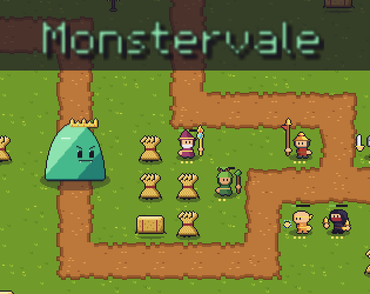
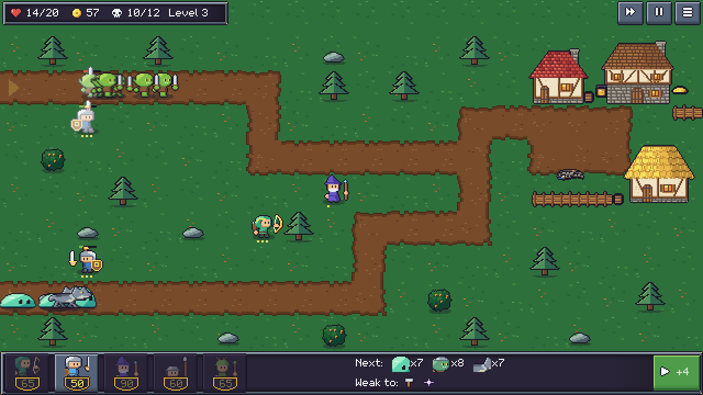
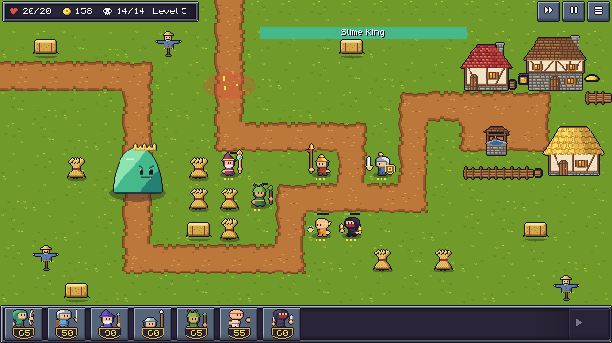

# Monstervale



Tower defense em pixel art: os monstros vêm pela estrada, e o vilarejo medieval só tem você. Posicione humanos ao longo do caminho, melhore cada um e escolha o dano certo para cada onda antes que os monstros cheguem às casas.

**Jogue no navegador ou baixe para Windows e Linux: [brenaki.itch.io/monstervale](https://brenaki.itch.io/monstervale)**

| | |
|---|---|
|  |  |

## Feito por IA, dirigido por uma pessoa

Todo o jogo (código, arte, sons, músicas, testes, builds e as imagens da página) foi feito pelo Claude Code, um agente de IA. Ele programou o jogo e usou servidores MCP para desenhar, rodar o jogo e testar a versão para navegador.

A pessoa que dirigiu o projeto não programou nem desenhou. Ela deu o direcionamento:

- **Decidiu o jogo.** Respondeu às perguntas de design: gênero, classes, monstros, fases, estilo visual e escopo. As respostas estão em [`docs/001-QUESTIONS.md`](docs/001-QUESTIONS.md) a [`docs/006-QUESTIONS.md`](docs/006-QUESTIONS.md) e viraram as decisões em [`docs/001-DECISOES.md`](docs/001-DECISOES.md).
- **Jogou e avaliou.** Jogou cada fase e disse o que estava fácil, difícil, feio ou confuso. Aprovou a arte de olho e os sons de ouvido.
- **Pediu mudanças.** Exemplos: ondas só começam quando o jogador chama, vila medieval que desmorona, tutorial, conquistas e o nome Monstervale ([`docs/007-IDEA.md`](docs/007-IDEA.md)).
- **Publicou.** Criou a página no itch.io e enviou os arquivos gerados pelo agente.

### Os MCPs usados

| MCP | Para quê |
|---|---|
| [Aseprite](https://www.aseprite.org/) | Desenhar toda a arte: humanos, monstros, Rei Slime, terrenos, vila, interface, fonte e ícone, com animações e níveis de melhoria. |
| [Godot](https://godotengine.org/) | Rodar o jogo, tirar capturas de tela, executar scripts dentro da partida e conferir o resultado visual de cada mudança. |
| Playwright | Testar a versão web no navegador, pesquisar a documentação do itch.io e conferir a página publicada. |
| Context7 e Exa | Consultar documentação e referências durante o desenvolvimento. |

Algumas imagens de terceiros serviram só como referência de estilo durante as conversas. Elas ficam fora do repositório, e nenhuma arte do jogo foi copiada ou decalcada delas.

## Como o jogo foi feito

- **Engine:** Godot 4.7 com GDScript, renderizador de compatibilidade (roda no navegador e no desktop).
- **TDD do começo ao fim:** cada regra nasceu de um teste com [GUT](https://github.com/bitwes/Gut). São 592 testes, entre unidade, balanceamento e ponta a ponta.
- **Partidas reais como testes.** Cada partida jogada gera um relatório em Markdown e JSON. As partidas aprovadas pela pessoa viraram testes e2e em [`tests/fixtures/partidas/`](tests/fixtures/partidas): o teste repete os cliques reais pela interface e confere que a fase continua vencível com 3 estrelas. Assim, cada ajuste de balanceamento é comparado com quem joga de verdade.
- **Arte gerada por scripts.** Os scripts Lua em [`tools/`](tools) desenham os terrenos, a vila, a interface e a fonte no Aseprite, e [`tools/build_assets.gd`](tools/build_assets.gd) transforma as folhas em SpriteFrames e TileSets.
- **Sons e músicas sintetizados.** Não há sons de terceiros: [`src/core/synth.gd`](src/core/synth.gd) gera os efeitos e as músicas chiptune a partir de [`data/sounds.json`](data/sounds.json) e [`data/music.json`](data/music.json).
- **Imagens da página geradas pelo próprio jogo.** [`tools/render_promo.gd`](tools/render_promo.gd) repete as partidas aprovadas e captura os prints, a tela de abertura e a capa.

## Linha do tempo

| Data | Etapa |
|---|---|
| 2026-11-06 | Perguntas de design, escolha do Godot e Fase 1 jogável |
| 2026-11-06 | Relatórios de partida, animações reais e o primeiro ajuste de dificuldade com base nas partidas da pessoa |
| 2026-11-06 | Fase 2 (pântano, slimes e mago) e as partidas reais como testes e2e |
| 2026-11-06 | Fase 3 (floresta, lobos, lanceiro e druida), menu e marcador de vida da vila |
| 2026-11-07 | Fase 4 (cemitério, esqueletos, monge e ladino) |
| 2026-11-07 | Fase 5 (arredores do vilarejo e o Rei Slime, que se divide ao apanhar) |
| 2026-11-07 | Tela de título, sons e músicas, opções, ondas chamadas pelo jogador, vila medieval que desmorona, tutorial interativo, conquistas e o nome Monstervale |
| 2026-11-07 | Ícone, tela de abertura, capa, prints, textos da página e publicação no itch.io |

O histórico completo está no `git log`. O projeto começou com o nome provisório DT-SLIME.

## O jogo

- 5 fases: campo, pântano, floresta, cemitério e as lavouras na entrada do vilarejo.
- 7 humanos: Arqueiro, Guerreiro, Mago, Lanceiro, Druida, Monge e Ladino, cada um com 3 níveis de melhoria.
- Monstros: goblins, slimes, lobos, esqueletos e o Rei Slime.
- Dano perfurante, mágico e de impacto; os monstros aguentam uns e sofrem com outros.
- Guerreiros, lanceiros e monges seguram os monstros na estrada, e cada humano pode mirar o primeiro, o último, o mais forte ou o mais perto.
- O jogador decide quando cada onda começa; chamar cedo rende ouro extra.
- Cada monstro que passa custa vidas, e a vila desmorona: primeiro o poço, depois as casas.
- Até 3 estrelas por fase, 8 conquistas (incluindo Speedrunner) e tutorial interativo.
- Português e inglês. Só mouse.

## Rodar, testar e exportar

Precisa do [Godot 4.7](https://godotengine.org/download). Os comandos abaixo usam `godot` como o binário do Godot.

```bash
# Abrir no editor
godot -e --path .

# Rodar todos os testes sem janela (GODOT aponta para o binário)
GODOT=godot tools/test.sh

# Exportar (precisa dos export templates do Godot 4.7)
godot --headless --export-release Web
godot --headless --export-release Linux
godot --headless --export-release Windows

# Gerar de novo os prints, a tela de abertura e a capa (precisa de janela)
godot --path . -s tools/render_promo.gd -- en
```

## Estrutura

```
src/core/       regras do jogo: simulação, progresso, conquistas, sintetizador
src/game/       cenas e interface: HUD, título, tutorial, vila, opções
data/           unidades, monstros, fases, sons, músicas, tutorial e textos (PT/EN)
art/            arquivos do Aseprite
assets/         sprites, interface, sons e músicas exportados
tools/          scripts que geram arte, áudio, assets e imagens da página
tests/          testes de unidade, balanceamento e e2e com partidas reais
docs/           perguntas de design e decisões
promo/          capa, prints e textos da página do itch.io
```
